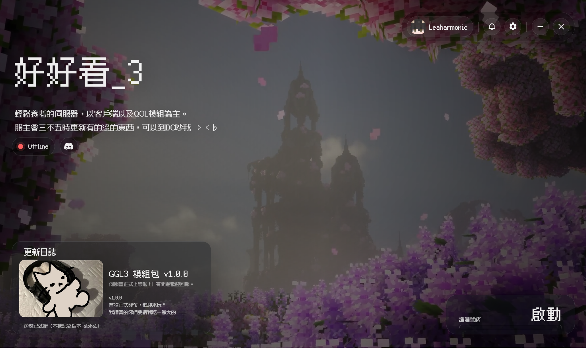

# GGL Launcher

##### 年糕 122 做ㄉ GGL3 Minecraft 專用模組伺服器的啟動器：安裝、更新模組包、遊戲環境建構、遊戲啟動入口。><b

---

## 基本功能

- **安裝、更新、修復模組包**：從 GGL3 站台讀取模組包版本以及檔案清單，只下載或替換內容不一樣的檔案；設定與存檔等等玩家自己改過的東西有保護規則（見 [疑難排解](docs/player-troubleshooting.md)）。
- **遊戲環境建構**：一鍵下載需要的 Minecraft、Fabric 與 Java，用以啟動遊戲。
- **Microsoft 登入**：用你的 Microsoft 帳號登入 Minecraft。
- **維護啟動**：維護期間不能安裝或更新，但依然能以現有版本啟動。
- **離線啟動**：可以用離線身分啟動 Minecraft，例如單人遊玩。GGL3 伺服器要求正版登入，所以離線身分不能通過它的驗證。
- **資訊更新**：更新日誌、伺服器資訊通知（右上角鈴鐺）以及 Online/Offline 紅綠燈顯示。
- **診斷報告**：在設定裡按「匯出診斷報告」（內容與分享前的檢查見疑難排解第 7 節）。
- **Discord 狀態顯示**（只有 Windows 版）：電腦上開著 Discord 的話，遊戲期間會在你的 Discord 個人狀態顯示 GGL 遊玩狀態（隱私說明見下方）。

## 基本操作

1. 安裝並打開啟動器。可以在設定裡選遊戲的安裝位置。
2. 要上伺服器，先按右上角的「登入」，用 Microsoft 帳號登入。
3. 主畫面右下角的大按鈕會依狀態顯示成「安裝」、「更新」或「啟動」，照它做。
4. 遊戲檔案不見了或壞了：設定裡有「檢查並修復檔案」。
5. 狀態卡顯示「啟動器版本過舊」：按「開啟下載頁」下載新版。

## 問題回報

- 先看 **[docs/player-troubleshooting.md](docs/player-troubleshooting.md)** 疑難排解：更新卡死、維護、版本過期、壞檔、Windows 安裝阻擋、Mac 與 Linux 的安裝，以及診斷報告匯出。
- 要回報問題時，診斷報告**會包含電腦的使用者名稱與路徑**，分享前請檢查、不公開；回報請向 GGL 管理員聯繫。

## 隱私與網路連線

- GGL 沒有使用分析或遙測，也不會自動上傳診斷報告。啟動器會連線到 GGL3、Microsoft／Minecraft、Mojang、Fabric 及 Java 下載服務；連線時對方能看到你的 IP 位址。

- **玩家頭像**：使用 `crafatar.com`、`visage.surgeplay.com` 取得頭像（傳送 Minecraft UUID）；兩者都失敗時，才向 `mc-heads.net` 傳送玩家名稱。

- **Discord 狀態**（只有 Windows 版）：遊戲啟動後，啟動器會執行一支輔助程式，GGL 會透過電腦上的 Discord 顯示遊玩狀態。**經由 Discord 用戶端顯示的活動，等於交給 Discord 這個第三方服務**。

## 技術文件

- [docs/release-runbook.md](docs/release-runbook.md)：安裝檔建構與發版步驟（哪些做過、哪些還沒）。
- [docs/site-format.md](docs/site-format.md)：站台檔案格式。
- [docs/player-troubleshooting.md](docs/player-troubleshooting.md)：給玩家的疑難排解。
- [ARCHITECTURE.md](ARCHITECTURE.md)：架構與 IPC 清單。
- [\_notes/conventions.md](_notes/conventions.md)：專案做事細則。

---

## Windows 可能會警告安裝檔

安裝檔**沒有程式碼簽章**，Windows 的 SmartScreen 可能對它跳出警告。警告本身不代表檔案有問題，也不代表安全：請確認是從 Release 下載頁下載、並對照 SHA-256 之後再決定。做法與注意事項見 [docs/player-troubleshooting.md](docs/player-troubleshooting.md) 第 6 節。

Mac 版與 Linux 版同樣沒有簽章，第一次打開要多做一步，見同一份文件的第 8、9 節。

## 系統需求

- **Windows 11 x64**：支援，已驗證。
- **Windows 10 x64**：支援，未實測。
- **macOS（Apple 晶片，M1 以後）**：支援，已在 macOS 26 驗證。Intel 處理器的 Mac 不支援。
- **Linux x64**：支援，已在 Linux Mint 22.3 驗證，其他發行版未實測。安裝檔是 AppImage。
- **網路**：第一次安裝要下載模組包、遊戲本體與 Java，需要時間與磁碟空間。
- **Minecraft帳號**：要連接 GGL3 伺服器，需要擁有 Minecraft Java 版的 Microsoft 帳號。
